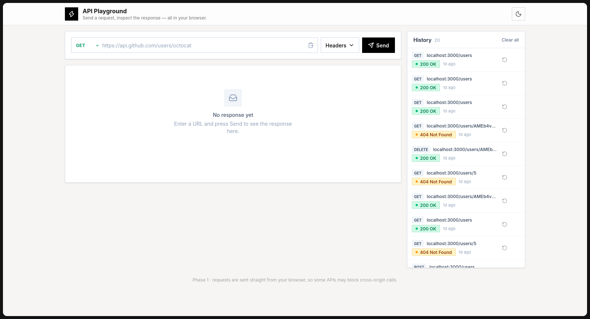
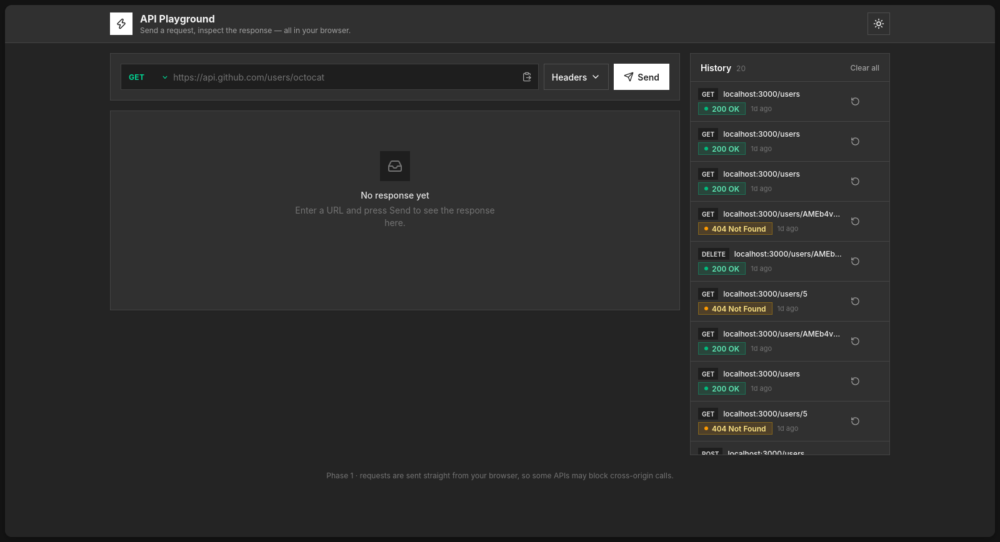
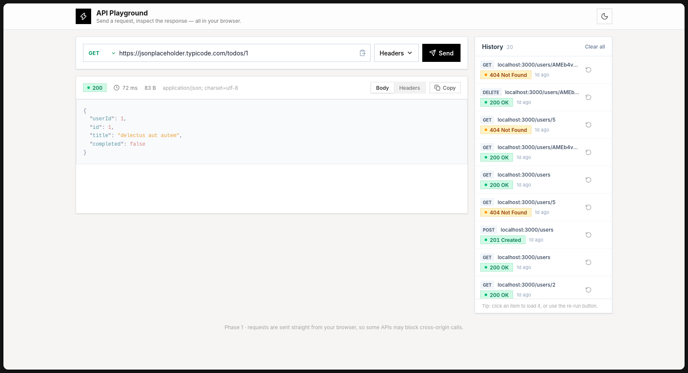
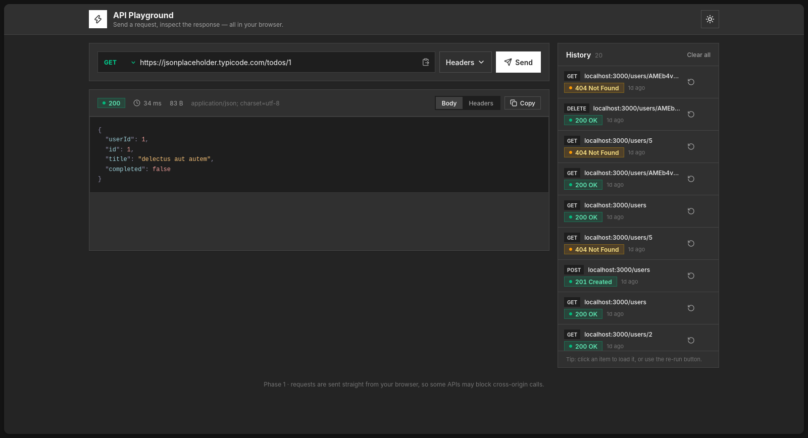

# API Playground

A lightweight, browser-based tool for sending HTTP requests and inspecting the
response think of it as a simplified Postman that runs entirely in your
browser with no backend.

Enter a URL, optionally add request headers, hit **Send**, and see the
formatted response body, HTTP status, response time, and size. Recent requests
are saved locally so you can re-run them later.

## Features

- **GET, POST, PUT, PATCH, and DELETE requests** from a URL input click
  **Send** or press **Enter**.
- **Request body** for non-GET methods, sent as JSON when it looks like JSON.
- **URL validation** with a clear error before any request is made.
- **Formatted JSON** responses (and plain text for everything else).
- **Status badge** for the HTTP status code/text, colored by class
  (2xx / 3xx / 4xx / 5xx) and labeled so it never relies on color alone.
- **Response time** (ms) and **response size**.
- **Custom request headers** add, edit, enable/disable, and remove
  key/value pairs.
- **Response headers** in a dedicated tab.
- **Copy** the response body to the clipboard.
- **Request history** (last 20) persisted in `localStorage`, with load,
  re-run, delete, and clear-all actions.
- **Loading, empty, and error states**, including specific messages for
  invalid URLs, network failures, CORS blocking, and timeouts.
- **Cancel** an in-flight request.
- Responsive layout (works from 360px up) with a light/dark theme toggle.

## Tech Stack

- [React](https://react.dev) + [TypeScript](https://www.typescriptlang.org)
- [Vite](https://vite.dev)
- [Tailwind CSS](https://tailwindcss.com) v4
- [Zustand](https://zustand-demo.pmnd.rs) for state, persisted to
  `localStorage`

## Getting Started

Requires Node.js 20+ and [pnpm](https://pnpm.io).

```bash
pnpm install
pnpm dev
```

Then open the printed local URL (default `http://localhost:5173`).

### Scripts

| Command | Description |
| --- | --- |
| `pnpm dev` | Start the dev server with HMR |
| `pnpm build` | Type-check and build for production |
| `pnpm preview` | Preview the production build |
| `pnpm lint` | Run Oxlint |

## Usage

1. Pick a method and paste an API URL, e.g. 

```
https://api.github.com/users/octocat
```

2. (Optional) Open **Headers** to add request headers, and **Body** (for
   non-GET methods) to add a request body.
3. Press **Send** (or Enter).
4. Switch between the **Body** and **Headers** tabs, and copy the body if
   needed.
5. Click a **history** item to load it, or use the re-run button.

### Try it

- `https://api.github.com/users/octocat`
- `https://jsonplaceholder.typicode.com/todos/1`
- `https://httpstat.us/404` (to see the error styling)

## Screenshots


### Light Theme


### Dark Theme


### Request View


### Response View


